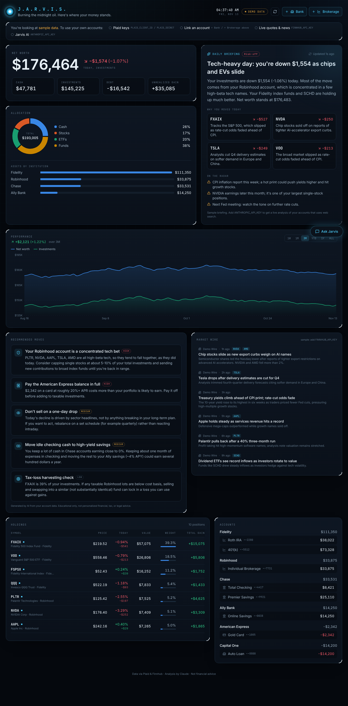

# J.A.R.V.I.S. · Personal Wealth Command Center

A live, self-hosted dashboard that connects to your bank and brokerage accounts (Chase, Ally, Amex, Robinhood, Fidelity, and anything else Plaid supports). It shows your net worth and performance in real time and uses Claude as a "Jarvis" that explains why your accounts moved, suggests what to do, and answers questions.



## What it does

| Panel | What you get | Refresh |
|---|---|---|
| **Net worth** | Assets − debts across every linked account, with today's $ / % move | every 20s |
| **Daily briefing** | Claude reads your positions and today's news, searches the web, and explains in plain English why you're up or down and which holdings drove it | every 30 min (or on demand) |
| **Recommended moves** | Prioritized suggestions based on your actual accounts: concentration risk, idle cash, high-interest debt, tax-loss harvesting, rebalancing | with the briefing |
| **Performance** | Net worth and investments over 1W / 1M / 3M / YTD / 1Y / ALL | every 5 min |
| **Allocation** | Cash / stocks / ETFs / funds, plus assets by institution | live |
| **Holdings** | Every position with live price (flashes on change), today's move, weight, and total gain | every 20s |
| **Market wire** | Market headlines plus news about the stocks you own, tagged by ticker | every 5 min |
| **Ask Jarvis** | Chat that knows your portfolio and can search the web ("Why am I down?", "Should I rebalance?") | streaming |

It runs on **realistic demo data** until you add keys, so you can see the full experience right away.

## Quick start

```bash
cd jarvis
npm install
cp .env.example .env.local   # then fill in keys (see below)
npm run dev                  # http://localhost:3000
```

## Keys you need (all have free tiers)

1. **Plaid**: connects banks, credit cards, loans, and brokerages.
   - Sign up at https://dashboard.plaid.com and copy your `client_id` and secret.
   - Start with `PLAID_ENV=sandbox`. Click **+ Bank** or **+ Brokerage**, pick any institution, and log in with `user_good` / `pass_good` to see fake data flow through.
   - For **your real accounts**, request Production access in the Plaid dashboard (free for limited personal use under their "Trial" plan), then set `PLAID_ENV=production` and use your production secret.
   - Use **+ Bank** for checking, savings, credit cards, and loans. Use **+ Brokerage** for Robinhood, Fidelity (brokerage, IRA, 401k), Schwab, Vanguard, and similar.
2. **Finnhub**: live quotes and news. Free key at https://finnhub.io/register.
3. **Anthropic**: the AI briefing, recommendations, and chat. Key at https://platform.claude.com/settings/keys. Uses Claude Opus 5.5 with web search. A briefing typically costs a few cents; it is cached for 30 minutes.

Restart `npm run dev` after editing `.env.local`.

## How it works

```
Browser (Next.js + SWR polling)
   │
   ├── /api/portfolio ──► Plaid (balances + holdings, cached 5 min)
   │                  └─► Finnhub live quotes (cached 20s) → live values + day change
   ├── /api/history ───► snapshots saved to data/history.json every 15 min
   ├── /api/news ──────► Finnhub market + company news (cached 10 min)
   ├── /api/briefing ──► Claude + web search → structured JSON briefing (cached 30 min)
   └── /api/chat ──────► Claude streaming chat with your portfolio as context
```

- **Performance history**: Plaid provides current balances, not past ones, so Jarvis records a snapshot whenever the dashboard is running. The chart fills in over time. To build history continuously, leave it running on a home server, Raspberry Pi, or always-on machine.
- **Mutual funds and 401(k) funds** that Finnhub doesn't quote use the price your brokerage reports via Plaid, which updates about daily.
- Plaid access tokens are stored in `data/plaid-items.json` (gitignored, file mode 600).

## Security: this is your financial data

- Run it on `localhost`. If you expose it anywhere else, **set `DASHBOARD_PASSWORD`** (enables HTTP Basic auth on every page and API route) and put it behind HTTPS.
- Never commit `.env.local` or `data/`. Both are in `.gitignore`.
- Plaid access is read-only. Nothing in this app can move money or place trades.

## Not financial advice

Recommendations are generated by AI from your data. They are for education and to prompt your own thinking, not personalized investment, tax, or legal advice.
